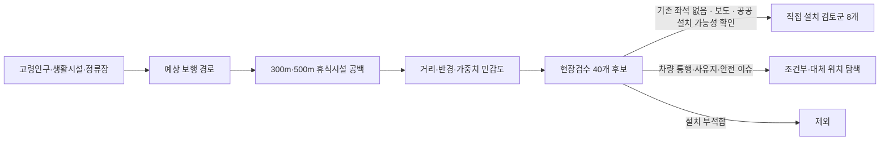

# 대구 달서구 고령자 보행 휴식시설 우선 검토

[](https://cres17.github.io/daegu-dalseo-senior-bench/)
[](https://github.com/cres17/daegu-dalseo-senior-bench/actions/workflows/deploy-pages.yml)

대구광역시 달서구에서 고령자의 **예상 보행 수요**와 기존 벤치·버스정류장 의자까지의 거리를 결합해, 신규 휴식시설의 **현장조사 우선 검토구간**을 도출한 공간분석 프로젝트입니다.

> 이 프로젝트는 실제 개인 이동 경로나 최종 설치 위치를 산정하지 않습니다. 결과는 현장조사와 관계기관 협의를 먼저 수행할 구간을 선별하는 의사결정 지원 자료입니다.

## 한눈에 보기

최신 v2 현장검수 통합 결과 기준입니다. 지도에서 각 후보를 클릭하면 선택 근거와 현장 확인 항목을 확인할 수 있습니다.

➡️ **[인터랙티브 후보 지도 열기](https://cres17.github.io/daegu-dalseo-senior-bench/)**

| 항목 | 결과 |
| --- | ---: |
| 예상 OD 보행 경로 | 82,833건 |
| 모델링 TOP 후보 고유 도로 | 39개 |
| 민감도 순위 조합 | 36개 |
| v2 현장검수 후보 | 40개 |
| 직접 설치 검토군 (`INSTALLABLE`) | 8개 |
| 조건부·대체 위치 탐색군 | 18개 |
| 현장 설치 부적합 제외군 | 14개 |

### 직접 설치 검토군 선정 기준

아래 흐름을 모두 통과한 구간만 지도에 표시했습니다. 분석 점수만으로 설치를 확정하지 않고, 현장검수 결과를 최종 필터로 적용했습니다.



| 선정 근거 | 지도에서 보여주는 값 |
| --- | --- |
| 고령자 수요 | 행정동 65세 이상 인구, 고령인구 밀도 |
| 휴식시설 부족 | 적응형 공백 기준, 공백 길이, 최대 좌석거리 |
| 보행 연결성 | 800m 예상 경로 수, 민감도 시나리오 출현 횟수 |
| 설치 가능성 | 기존 좌석, 보도 연속성, 경사, 횡단 위험, 그늘, 공공 설치 가능성 |

상세 근거와 한계는 [평가 결과 보고서](05_evaluation/01_Evaluation_결과_보고서.md), [현장조사 통합 평가 보고서](05_evaluation/06_현장조사_통합_평가_보고서.md), [v2 현장검수 통합 결과](05_evaluation/08_v2_현장검수_통합결과.md)에서 확인할 수 있습니다.

## 분석 흐름

```text
공공·공간 데이터 수집 및 품질 점검
  → 분석 레이어 전처리(EPSG:5179)
  → 예상 보행 경로·휴식시설 공백 모델링
  → 거리·반경·가중치 민감도 평가
  → 현장조사 반영 및 2차 우선순위
  → 지도 대시보드 배포
```

- 휴식시설 공급은 공개 이용 가능한 공원 벤치와 버스정류장 의자로 한정했습니다.
- 벤치 공백은 300m·500m 네트워크 거리 기준으로 비교했습니다.
- 계단 포함·제외, OD 반경 500m·800m·1,200m, 수요 가중치 35%·50%·65%를 조합해 민감도를 점검했습니다.
- 계단 포함 여부의 TOP 20은 모든 조합에서 일치했고, 후보군은 가중치보다 생활권 반경 변화에 더 민감했습니다.

## 저장소 구성

| 경로 | 내용 |
| --- | --- |
| `01_business_understanding` | 문제 정의와 분석 요건 |
| `02_data_understanding` | 데이터 명세·품질 점검·OSM 보행망 수집 코드 |
| `03_data_preparation` | 분석 레이어 전처리 코드와 검증 문서 |
| `04_modeling` | 예상 보행 경로·벤치 공백 모델과 결과 보고서 |
| `05_evaluation` | 민감도·현장조사 통합 평가 코드와 보고서 |
| `06_deployment` | 대시보드 운영·사용·갱신 문서 |

## 재현 방법

원천 공공데이터·공간 데이터 및 생성 산출물은 용량과 갱신 주기 때문에 이 저장소에 포함하지 않습니다. 필요한 입력 파일을 준비한 뒤 각 단계의 실행 가이드를 순서대로 따르세요.

```bash
python3 -m venv .venv
source .venv/bin/activate
python -m pip install -r 02_data_understanding/requirements-osmnx.txt
python -m pip install -r 03_data_preparation/requirements-data-preparation.txt
python -m pip install -r 04_modeling/requirements-modeling.txt
python -m pip install -r 05_evaluation/requirements-evaluation.txt
```

실행 순서와 입력·출력 정의는 다음 문서를 참고하세요.

1. [전처리 실행 가이드](03_data_preparation/03_실행_가이드.md)
2. [모델 실행 및 후보 검토 가이드](04_modeling/04_실행_및_후보검토_가이드.md)
3. [Evaluation 실행 가이드](05_evaluation/04_실행_가이드.md)
4. [데이터 갱신 및 재분석 절차](06_deployment/03_데이터_갱신_및_재분석_절차서.md)

대시보드는 별도 Git 저장소에서 관리합니다. 대시보드에 사용하는 후보 CSV·GeoJSON은 원천·분석 데이터이므로 이 저장소에 포함하지 않습니다.

## 해석 및 사용상 주의

- 버스 이용량은 고령자 이용량이 아니라 전체 연령 이용량의 대리변수입니다.
- 행정동 고령인구는 대표점으로 연결했으므로 동 내부의 실제 분포를 완전히 표현하지 못합니다.
- 공원 벤치 자료 기준일과 OSM 보행망의 누락·오분류 가능성을 현장조사로 보완해야 합니다.
- 분석 점수는 설치 확정 근거나 행정적 의사결정을 대체하지 않습니다.

## 라이선스

원천 데이터의 이용 조건을 각각 확인해야 합니다. 이 저장소의 코드와 문서는 별도 라이선스 파일을 추가하기 전까지 모든 권리를 보유합니다.
