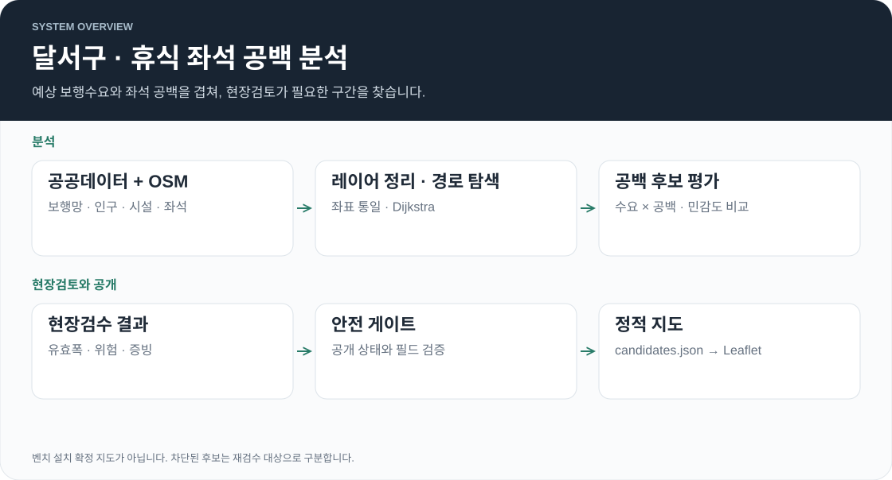

# 달서구 어르신 휴식 좌석 공백 분석

대구 달서구에서 어르신이 자주 걸을 것으로 예상되는데 앉아 쉴 곳까지 멀리 가야 하는 길을 공공데이터와 OpenStreetMap 보행망으로 찾고, 현장검수 결과를 안전 기준으로 다시 걸러 지도로 공개한 프로젝트입니다. 결과는 벤치 설치 위치가 아니라 현장조사와 관계기관 협의를 먼저 할 구간이며, 실제 고령자의 GPS 이동 기록은 쓰지 않았습니다.

- [공개 지도](https://cres17.github.io/daegu-dalseo-senior-bench/) · [기술 · 검증 보고서](https://cres17.github.io/daegu-dalseo-senior-bench/final-review.html) · [사용한 데이터와 기준시점](DATA_SOURCES.md)
- 현재 공개 결과: v2 현장검수 후보 40개 중 `INSTALLABLE` 8개가 설치 후 유효폭 · 측정 근거 누락으로 안전 게이트에서 차단되어, 지도에는 이 8개를 재검수 후보로 표시합니다.

## 전체 아키텍처

  

Python 스크립트가 단계별로 산출물을 만들고, 마지막에 공개해도 되는 필드만 담은 `docs/candidates.json`을 정적 지도가 읽습니다. 서버나 런타임 DB는 없습니다. 폴더는 CRISP-DM 단계 순서를 따릅니다.

| 단계 | 스크립트 | 하는 일 |
|------|----------|--------|
| 보행망 수집 · 검수 | `02_data_understanding/scripts/collect_osmnx_walk_network.py`, `audit_…`, `apply_manual_review_decisions.py` | 달서구 경계 500m 버퍼로 보행망 수집, 연결성 · 계단 · 서비스도로 자동 검수와 수동 판정 반영 |
| 레이어 정리 | `03_data_preparation/scripts/prepare_analysis_layers.py` | 고령인구 · 경로당 · 복지시설 · 의료기관 · 공원 · 정류장 · 벤치를 EPSG:5179 좌표로 맞추고 입력 SHA-256 기록 |
| 모델링 | `04_modeling/scripts/model_expected_walk_and_bench_gaps.py` | 출발지-목적지 예상 보행 경로와 도로 구간별 가장 가까운 좌석까지의 거리 계산 |
| 민감도 평가 | `05_evaluation/scripts/evaluate_priority_candidates.py` | 계단 · 공백 기준 · 생활권 반경 · 가중치를 바꾼 36개 조건의 순위 비교 |
| v2 재산정 | `revalidate_and_revise_candidates.py` | 1차 현장 결과를 반영해 고령인구 밀도 · 목적지 근거 기준으로 후보 40개 재선정 |
| 안전 게이트 | `integrate_v2_field_review_results.py` | 현장 판정이 `INSTALLABLE`이어도 유효폭 · 경사 · 횡단 위험 · 검토자 · 증빙을 다시 확인 |
| 공개 데이터 | `build_public_review_data.py` | 통과 후보(없으면 차단된 후보)만 공개 필드로 변환, 차단 후보가 섞이면 생성 중단 |

## 각 기술 설명

### OSMnx · OpenStreetMap

`collect_osmnx_walk_network.py`에서만 OSMnx(2.1 계열)를 씁니다. `graph_from_polygon`으로 보행 가능 도로를 받고, `project_graph`로 투영한 뒤 GraphML과 GeoPackage로 저장합니다. 이후 단계는 이 GeoPackage를 입력으로 씁니다. OSM은 계속 수정되므로 다시 수집하면 과거 보행망과 같지 않을 수 있어, 수집 시점과 결과 요약을 함께 기록합니다.

### pandas · NumPy

모든 분석 단계의 표 처리와 계산을 맡습니다. 공간 연산 라이브러리 없이 직접 구현한 부분이 많습니다.

| 기능 | 구현 |
|------|------|
| 좌표 변환 | 위경도 ↔ EPSG:5179(TM) 변환식을 NumPy로 구현 (`forward_tm_5179`, `inverse_epsg5179`) |
| SHP · DBF 읽기 | `struct`로 행정동 경계 Polygon과 속성 파일을 직접 파싱 |
| GeoPackage 읽기 | `sqlite3`로 GeoPackage의 WKB 바이너리를 읽어 LineString으로 디코딩 |
| 경로 탐색 | `heapq` 기반 Dijkstra. 시설을 가까운 노드가 아니라 가장 가까운 도로 엣지에 투영해 연결 |
| 좌석 공백 | 도로를 최대 25m 간격으로 나눠, 보행망을 따라 가장 가까운 벤치 · 정류장 의자까지의 거리를 다중 시작점 Dijkstra로 계산 |
| 우선 점수 | `√(예상 보행수요 백분위 × 휴식공백 백분위)` 기하평균. 한쪽 값만 큰 도로가 상위를 독차지하지 않게 함 |

생활권 반경은 500 · 800 · 1,200m를 비교하고 800m를 주 분석값으로 씁니다. 같은 좌표에 여러 행이 있는 의료기관은 하나의 위치로 합쳐 수요가 부풀지 않게 했습니다.

### openpyxl

새로 추가된 원천자료를 이전 프로파일과 비교 검증하는 `validate_updated_sources.py`에서 XLSX 파일을 읽을 때 씁니다.

### unittest — 안전 게이트 검증

`tests/test_v2_field_review_safety.py`의 14개 테스트가 안전 게이트 규칙을 고정합니다. 설치 후 유효폭은 2.0m 이상을 원칙으로 하고, 1.2~2.0m는 관리청 예외 승인 근거가 모두 있어야 하며, 1.2m 미만은 차단합니다. 공개 JSON에 차단 후보가 섞이지 않는지도 함께 검사합니다.

### Leaflet · JavaScript

`docs/index.html`이 Leaflet 1.9.4로 OpenStreetMap 타일 지도를 만들고, `fetch('./candidates.json')`으로 후보를 읽어 요약 숫자 · 마커 · 후보 카드를 그립니다. 후보를 누르면 예상 수요 · 휴식 공백 · 안전 게이트 차단 사유를 보여 줍니다. `docs/final-review.html`은 분석 과정과 검증 결과를 정리한 보고서 페이지입니다.

### GitHub Pages · GitHub Actions

`deploy-pages.yml`이 `main`의 `docs/` 폴더를 GitHub Pages에 배포합니다. 공개 결과가 바뀌면 커밋 단위로 언제 어떤 후보가 공개됐는지 추적할 수 있습니다.
